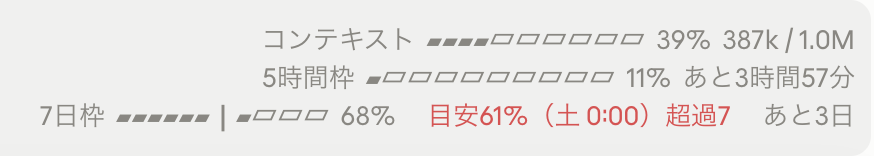
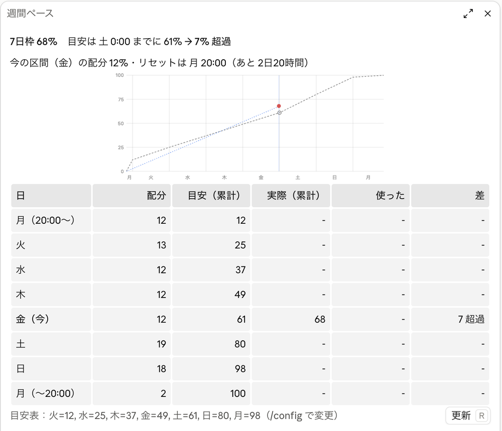

# usage-log

Claude Code の利用枠（5 時間枠・7 日枠）の使用率を、ターンが終わるたびに記録する mod。自分で決めた週の目安と比べて、使いすぎか、まだ余裕があるかも分かります。

[](https://code.claude.com/docs/en/plugins/mods/overview)
[](https://www.anthropic.com/claude)
[](./LICENSE)

<p align="center">
  
</p>

**Claude Code × Claude Opus 5.5（XHIGH）** で作りました。

Claude Code の週の利用枠を、気づいたら木曜で使い切っていた、ということを避けたくて作りました。ターンが終わるたびに、その時刻と 5 時間枠・7 日枠の使用率を 1 行ずつファイルに残し、あとから「何曜日の時点で、平均どれくらい使っているか」を集計できます。土日を厚めにするなど、自分で決めた週の配分（目安）を設定すると、今の使用率との差を入力欄の上の帯（別の mod [clawd-dance](https://github.com/tanuu5/clawd-dance)）に出せます。

## 記録するもの

記録先は `~/.claude/usage-log/turns.jsonl` です。本体のターンが終わるたびに 1 行（JSON）を書き足します。同時に開いている複数のセッションが、同じファイルに書き足します。

| 項目 | 中身 |
| --- | --- |
| 時刻 | `ts`（UTC）、`local`（時差つきのローカル時刻）、`dow`（曜日、0 = 日曜）、`hour` |
| 利用枠 | `limits.five_hour` と `limits.seven_day`：ターンの終わりの使用率 `pct`、始まりの使用率 `startPct`、リセットの時刻 `resetsAt` |
| どこで・何で | `session`（セッション ID）、`turn`（そのセッションで何回目の発言か）、`cwd`（作業フォルダ）、`model`、`effort`（推論強度）、`surfaces`（デスクトップかターミナルか）、`cc`（Claude Code の版）、`mod`（この mod の版） |
| どれだけ | `durationMs`（ターンの長さ）、`reason`（正常終了・中断・エラー）、`context`（コンテキストの使用量）、`costUsd`・`turnCostUsd`（API 料金に換算した額。セッションの累計と、そのターンの分）、`tokens`（本体のトークン数）、`subTokens`（サブエージェントの分） |
| 何をしたか | `steps`（API 呼び出しの回数）、`tools`・`toolCounts`（ツールの使用回数と内訳）、`subagents`（サブエージェントの数）、`promptChars`・`answerChars`（発言と返答の文字数） |

- 発言や返答の本文は残しません。文字数だけです。
- 記録はこの Mac の中だけに置かれ、どこにも送りません。
- サブエージェントが使った分は、そのとき進んでいた本体のターンの行にまとめます。

<details>
<summary>1 行の例（作業フォルダとセッション ID は伏せています）</summary>

```json
{
  "v": 1,
  "ts": "2026-10-02T14:26:45.472Z",
  "local": "2026-10-02T23:26:45+09:00",
  "dow": 5,
  "hour": 23,
  "session": "（セッション ID）",
  "turn": 9,
  "cwd": "/path/to/my-app",
  "model": "claude-opus-5-5",
  "effort": "xhigh",
  "surfaces": ["desktop"],
  "cc": "2.1.286",
  "mod": "0.3.0",
  "reason": "answer",
  "durationMs": 63732,
  "limits": {
    "five_hour": { "pct": 12, "startPct": 12, "resetsAt": "2026-10-02T18:20:00.000Z" },
    "seven_day": { "pct": 68, "startPct": 68, "resetsAt": "2026-10-05T11:00:00.000Z" }
  },
  "context": { "tokens": 407366, "window": 1000000, "pct": 41 },
  "costUsd": 14.4573,
  "turnCostUsd": 0.7459,
  "tokens": { "input": 12, "output": 5594, "cacheRead": 2405540, "cacheWrite": 19107 },
  "subTokens": { "input": 0, "output": 0, "cacheRead": 0, "cacheWrite": 0 },
  "steps": 6,
  "subSteps": 0,
  "tools": 7,
  "subTools": 0,
  "toolCounts": { "Bash": 5, "ToolSearch": 1, "mcp__ccd_session_mgmt__get_session": 1 },
  "subagents": 0,
  "promptChars": 149,
  "answerChars": 1110
}
```

</details>

## 週の目安と比べる

7 日枠について、「各曜日の 0:00 の時点で、累計で何 % まで使ってよいか」を目安として決めておきます。既定は次の表で、土日を厚めにした配分です（`/config` で変えられます）。

| 時点 | 火 0:00 | 水 0:00 | 木 0:00 | 金 0:00 | 土 0:00 | 日 0:00 | 月 0:00 |
| --- | --- | --- | --- | --- | --- | --- | --- |
| 累計の目安 | 12% | 25% | 37% | 49% | 61% | 80% | 98% |

- 枠のリセットの時刻は、Claude Code が受け取った値から自動で読みます。リセットの時点を 0%（始まり）と 100%（終わり）とし、その間に表の時点を並べます。
- 今の使用率を「次の時点の目安」と比べます。たとえば金曜の夜に 68% なら、土 0:00 の目安 61% に対して 7 超過です。
- 結果は `~/.claude/usage-log/pace.json` に書き出します。[clawd-dance](https://github.com/tanuu5/clawd-dance)（v0.12.0 以降）を一緒に入れていると、帯の 7 日枠の行に目安の位置（`┃`）と差が出ます。超過は赤、余裕は緑です（上の画像）。
- `/usage-log` と打つと、今週のグラフ（目安と実際の使用率の推移）と、曜日ごとの「配分・目安・実際・使った量・差」の表をパネルで開きます。記録先の場所と行数、直近の値も表示します。

<br>
<sub>`/usage-log` で開くパネル。灰色の点線が目安、青が実際の使用率、赤い点が今です。青の細い点線は記録を始める前の区間で、実際の推移は分かりません（この画像は記録を始めた日のもの）。</sub>

画像は、実際のアプリの画面を切り出したものです。

<details>
<summary>pace.json の中身（ほかの mod から読むとき）</summary>

```json
{
  "v": 1,
  "sevenDay": { "pct": 68, "resetsAt": "2026-10-05T11:00:00.000Z" },
  "fiveHour": { "pct": 13, "resetsAt": "2026-10-02T18:20:00.000Z" },
  "windowEnd": 1791198000000,
  "checkpoints": [
    { "at": 1790593200000, "pct": 0, "label": "月 20:00" },
    { "at": 1790607600000, "pct": 12, "label": "火 0:00" },
    { "at": 1791198000000, "pct": 100, "label": "月 20:00" }
  ],
  "updatedAt": "2026-10-02T14:32:06.779Z"
}
```

`sevenDay` と `fiveHour` は、どのセッションのものも含めていちばん新しい値です。`checkpoints` は今の 7 日枠の目安の時点（時刻はミリ秒、上の例は途中を省略）。値が変わったときだけ書き直します。

</details>

## 記録を集計する

リポジトリの `analyze.py`（Python 3 の標準ライブラリだけ）で、記録を表にします。

```bash
python3 analyze.py
```

記録ファイルの場所を変えたときはパスを渡します。目安表は `--pace "火=12, 水=25, 木=37, 金=49, 土=61, 日=80, 月=98"` のように渡せます（省略すると上の既定の表）。

リセットのチケットなどで枠の途中に使用率が戻ったとき（同じ枠の中で 5 ポイント以上下がったとき、または次の枠が前倒しで始まったとき）は、途中のリセットとみなします。その枠のリセット後の時点は「各曜日 0:00 の累計」の平均に入れず、表の下に注記します。増分はリセット後 0 から数え直します。記録ファイル自体は書き換えません。

出力の例です。記録がまだ少ないため、3 週間分のダミーデータで実行しました。

```text
■ 7日枠：各曜日 0:00 の時点の累計（平均）と目安
枠の切り替わり: 毎週月曜 20:00（記録にある枠 4 個）

時点                  平均 %  枠の数  今の枠 %  目安 %  平均−目安
--------------------  ------  ------  --------  ------  ---------
火 0:00               3.2     4       3.0       12      -8.8
水 0:00               16.1    4       17.6      25      -8.9
木 0:00               29.6    4       29.5      37      -7.4
金 0:00               42.5    4       41.8      49      -6.5
土 0:00               56.1    3       -         61      -4.9
日 0:00               75.2    3       -         80      -4.8
月 0:00               97.4    3       -         98      -0.6
月 20:00（リセット）  100.0   3       -         100     +0.0

■ 曜日ごとの消費
曜日  1日に使った7日枠 %（平均）  日数
----  --------------------------  ----
日    22.2                        3
月    5.1                         4
火    13.0                        4
水    13.5                        4
木    12.8                        4
金    12.4                        4
土    19.4                        3
```

このあとに、5 時間枠ごとの最高値、時間帯ごと・モデルと推論強度ごと・作業フォルダごとの消費が続きます。

- 使用率の増え方は、全セッションの記録を時刻順に並べ、直前の記録からどれだけ増えたかで数えます。同時に動くセッションの分を二重に数えないためです。
- 記録を始める前の時点は、値が分からないので平均に入れません。
- 同じ mod が二重に読み込まれて同じターンが 2 行になっていても、1 行として数えます。

## 気をつけること

- 利用枠の値は、Claude のサブスクリプション（Pro / Max）でログインしているときだけ届きます。API キーで使っているときは、`limits` が空のまま記録されます。
- 使用率はアカウント全体の値です。claude.ai やスマホのアプリで使った分も、次に記録される行の増え方に入ります。
- 使用率は整数で届くので、1 ターンでの増え方はたいてい 0 か 1 です。日単位・週単位の集計に向いています。
- 枠の値は API の応答と一緒に届くため、新しいセッションは最初の応答まで値を持ちません。その間の目安の表示には、記録ファイルの最後の値（直前に別のセッションで記録した値）を使います。
- mod を入れた直後や書き換えた直後のターンは、記録されないことがあります（読み込みの切り替えと重なるため）。

## インストール

**動作環境**：Claude Code の mod の仕組み（function hooks）が入った版。公式の要件は v2.1.287 以上です。作者は macOS 版のデスクトップアプリ 2.19675.0（中に入っている Claude Code は 2.1.286）で確かめました。ターミナル版の Claude Code でも記録はできるつくりですが、作者は試していません。

ターミナルで次の 2 行を実行します。

```bash
claude plugin marketplace add tanuu5/usage-log
```

```bash
claude plugin install usage-log@usage-log
```

入れたあと、新しいセッションから記録が始まります。外すときは `/plugin` の画面で無効にするか、`claude plugin uninstall usage-log@usage-log` を実行します。記録ファイルは外しても残るので、要らなければ `~/.claude/usage-log/` を消してください。

### 設定を変える

`/config` の一覧に、次の 2 つが並びます。

| 項目 | 既定 | 内容 |
| --- | --- | --- |
| 記録ファイルの場所 | `~/.claude/usage-log/turns.jsonl` | `~` はホームフォルダ。pace.json はこのファイルと同じフォルダに書きます |
| 7日枠の目安（各曜日 0:00 の累計 %） | `火=12, 水=25, 木=37, 金=49, 土=61, 日=80, 月=98` | `曜日=累計%` をカンマで区切って並べます。読めない書き方のときは既定の表を使います |

記録ファイルの場所を変えたときは、pace.json の場所も変わります。clawd-dance は `~/.claude/usage-log/pace.json` だけを読むので、帯に目安を出したいときは既定の場所のままにしてください。

### この mod がすること・しないこと

mod は Claude Code の中で、あなたの権限のまま動きます。入れる前に中身を確かめてください。

- フックするイベント：`session.start`（コマンドの登録、1 分ごとの確認の開始）、`command.run`（`/usage-log`）、`turn.start`・`turn.step`・`tool.call`・`turn.complete`（ターンの始まりの値、API 呼び出し・ツールの回数、モデルと推論強度を数え、終わりに 1 行書く）、`session.measure`（利用枠が動いたことを知る）、`ui.close`・`ui.render`（このパネルだけ）
- `turn.step` と `tool.call` は数えるだけです。モデルへの依頼やツールの許可・入力は変えません。
- 実行するコマンド：`/bin/date +%z`（時差を知る）、`/bin/sh -c 'mkdir -p … && cat >> …'`（記録ファイルへの書き足し）、`tail`・`wc`（記録ファイルの末尾と行数を読む）
- 読み書きするファイル：記録ファイルと pace.json だけ。環境変数は `HOME` を読むだけです。
- ネットワーク通信、別モデルへの問い合わせ、会話の本文の保存はしません。

## 制作について

企画・ディレクション：**たぬ**　／　開発：**Claude Code（Claude Opus 5.5・推論レベル XHIGH）**

「毎セッション、対話が終わったら、その時刻と週間制限・時間制限の何 % かを記録したい。n 曜日の時点で平均どれくらい使うのかを知りたい」という一言から作りました。記録の仕組みはすぐに動いたので、次に土日を厚めにした目安表を足し、今の使用率との差を見えるようにしました。最初は入力欄の下、[dev-dashboard](https://github.com/tanuu5/dev-dashboard) のボタンの横に小さなチップとして置きました。しかし、その欄は収まらない分を「…」で隠してしまい、ボタンと並ぶとどちらかが見えなくなりました。そこで、すでに使用率を出していた clawd-dance の帯に、ファイル（pace.json）経由で目安を渡す形にしています。記録の分析（`analyze.py`）も、目安表と同じ「各曜日 0:00 の時点」で並べて、目安と見比べられるようにしました。

## 更新履歴

- **2026-10-02**：公開（v0.3.1）

## 開発

```text
.claude-plugin/marketplace.json        マーケットプレイスの定義
plugins/usage-log/
  .claude-plugin/plugin.json           mod の定義（/config の 2 項目）
  hooks/hooks.json                     読み込むモジュール
  hooks/register.tsx                   本体（記録、pace.json、パネル）
  hooks/pace.ts                        目安の計算とグラフの SVG（$ を使わない関数）
  tests/pace.test.tsx                  テスト（claude plugin test）
analyze.py                             記録の集計
```

手元の版を直接読み込むには、`claude --plugin-dir ./plugins/usage-log` で起動します。起動フラグを渡せないデスクトップアプリでは、`~/.claude/settings.json` の `env` に `CLAUDE_CODE_PLUGIN_DIRS` として、このフォルダの絶対パスを書きます（複数の mod を並べるときは `:` で区切ります）。

```bash
claude plugin validate ./plugins/usage-log
```

```bash
claude plugin test ./plugins/usage-log
```

型を確かめるには、mod を一度読み込ませて型定義（`.claude-plugin/types/`）を書き出させてから、`npx -p typescript tsc -p plugins/usage-log/tsconfig.json` を実行します。

## クレジット・ライセンス

- MIT License（[LICENSE](LICENSE)）© 2026 たぬ
- この mod は Anthropic とは関係のない個人の作品です。
- MIT License の対象はこのリポジトリのコードと文章です。「Claude」の名前や商標の使用を許諾するものではありません。
